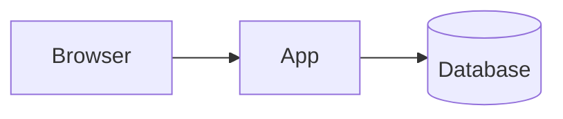

<!--
  README template: deployed application.

  Replace every placeholder, replace the example prose, then delete this comment block.
  Stack badges: copy from BADGES.md, which is sourced verbatim from Badges4-README.md-Profile.
  Keep the section names — they are the same in every repository.
-->

# {{PROJECT}}

{{TAGLINE}}

<!-- STATUS ROW — facts, small, fixed order: live · CI · license.
     Omit a badge entirely if the fact is not true. Never link a workflow that does not exist. -->
<p align="left">
  <a href="{{LIVE_URL}}"></a>
  <a href="https://github.com/{{OWNER}}/{{REPO}}/actions/workflows/ci.yml"></a>
  <a href="LICENSE"></a>
</p>

<!-- STACK ROW — identity, large, one line, 4–7 badges.
     Order: language → framework → styling → data → infrastructure.
     The example below is TypeScript; replace it with the real stack. -->
<p align="left">
  
</p>

<!-- WIP only. Delete this block when the project is shipped.
> **Status:** week 1 slice — what works, what does not, what is next.
-->

## About

Two to four sentences on what this is, who it is for, and the one constraint that makes
it interesting. No feature list here.

**Live:** [{{LIVE_HOST}}]({{LIVE_URL}})

## Screenshot


<!-- Optional detail shots:
| View | View |
| --- | --- |
|  |  |
-->

## Features

- **Bold lead-in** — what it does, and the constraint behind it when it matters.
- **Bold lead-in** — same shape.
- **Bold lead-in** — same shape.

## Quick Start

Requirements: {{REQUIREMENTS}}.

```bash
git clone git@github.com:{{OWNER}}/{{REPO}}.git
cd {{REPO}}
{{INSTALL}}
{{RUN}}
```

Open [http://localhost:5173](http://localhost:5173).

## Configuration

| Variable | Required | Description |
| --- | --- | --- |
| `{{ENV_VAR}}` | yes | {{ENV_DESCRIPTION}} |

## How It Works

Three to six bullets on the architecture, or a Mermaid diagram when the flow is not
obvious. Do not repeat the stack badges as prose.



## Testing

```bash
{{TEST_COMMAND}}
```

## Deployment

{{DEPLOYMENT}}

## Project Structure

```text
{{STRUCTURE}}
```

## Roadmap

- [x] {{DONE}}
- [ ] {{NEXT}}

## License

MIT © {{YEAR}} {{AUTHOR}}. See [LICENSE](LICENSE).

---

_{{PROJECT}} — {{FOOTER}}_
